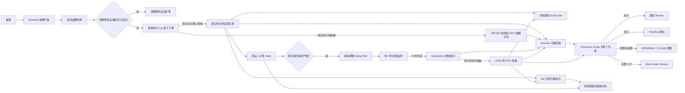
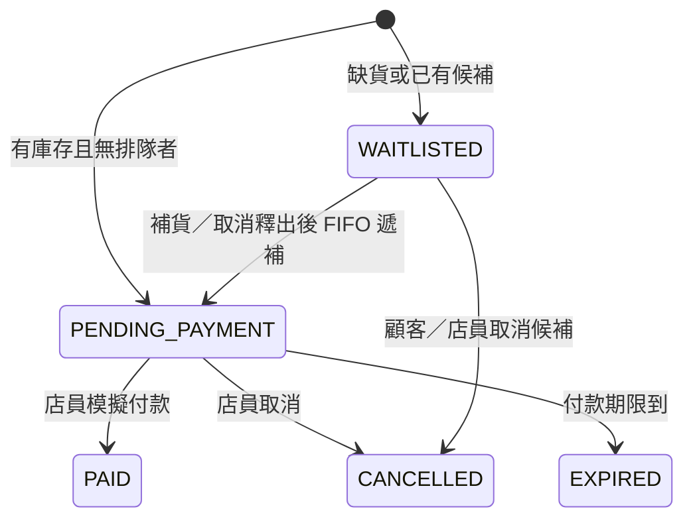

# 加分項實作與展示

## 一、對照老師的三項加分方向

### 1. 更完整的功能

- 顧客可將多項商品放入購物車，一次送出後每個品項各自建立訂單、保留庫存或進入該商品的 FIFO 候補佇列；購物車內可同時有待付款與候補品項。
- 每個品項以 Lua 腳本原子檢查庫存與每人限購、建立訂單、更新索引與期限，避免並行送單的讀寫競爭。
- 購物車與商品組合使用 24 小時冪等鍵；同一份購物車重送會取回原品項訂單，不重複扣庫存。
- 待付款訂單保留 5 分鐘；在 Streamlit 頁面保持開啟時，系統每 5 秒自動檢查付款期限。
- 取消或逾時會釋放預留庫存，並依候補順序遞補。
- 低庫存會安排模擬供應商補貨：門檻 ≤ 1 件、15 秒後補入 5 件。到貨後可自動遞補候補訂單。
- 顧客可按代號查詢自己訂單；店員可模擬付款或取消訂單。

### 2. 更好的 UI/UX

- 將操作分成「搶購商品」、「店員管理」、「訂單分析」三個分頁。
- 商品區顯示單價、剩餘庫存、限購量與候補人數。
- 商品選單有 10 項日常食品，並在資料檔中分開記錄 Open Food Facts 來源與專題模擬資料。
- 店員操作依待付款、取消與候補遞補分組，空狀態有提示。
- 訂單分析提供狀態篩選、顧客訂單查詢、營收與訂單狀態摘要。
- 自動補貨倒數、付款／候補結果和活動紀錄提供操作回饋。

### 3. 使用更多 Redis 進階功能

| Redis 功能 | 專題用途 | 重要操作 |
|---|---|---|
| Hash | 儲存商品與訂單欄位 | `HGETALL`、`HSET`、`HINCRBY` |
| String Counter | 計算顧客對單一商品的購買數 | `INCRBY`、`DECRBY` |
| List Queue | FIFO 候補 | `RPUSH`、`LPOP`、`LREM` |
| Sorted Set | 付款期限、補貨到貨期限排序 | `ZADD`、`ZRANGEBYSCORE`、`ZREM` |
| Set 次級索引 | 依商品、狀態、顧客快速查訂單 | `SADD`、`SREM`、`SINTER` |
| Aggregation Query | 統計訂單狀態數、已付款金額 | `SCARD` + Pipeline 讀取付款訂單金額後彙總 |
| Pipeline | 批次讀取訂單、建索引、執行分析查詢，減少往返 | `pipeline(transaction=False)` |
| Transactions | 搶購、付款、取消、遞補與補貨保持一致 | `WATCH`、`MULTI`、`EXEC` |
| Lua 原子下單 | 將單一商品的庫存、限購、訂單、索引、付款期限與事件寫入封裝成一次原子操作 | `EVALSHA`／`EVAL`（由 `register_script` 管理） |
| 冪等鍵 | 相同購物車重送時重用原品項訂單 | `SET ... EX 86400` |
| Streams | 保存不可覆寫的訂單與補貨活動紀錄 | `XADD`、`XREVRANGE` |
| Streams Consumer Group | 背景分派事件、成功確認、回收閒置工作 | `XGROUP`、`XREADGROUP`、`XACK`、`XPENDING`、`XCLAIM` |
| 重試與 Dead Letter | 連續處理失敗 3 次後保存到隔離 Stream | `worker:notifications:retry_counts`、`order:events:dead_letter` |
| Pub/Sub | 背景工作者完成事件處理後發布商品更新通知 | `PUBLISH`、`SUBSCRIBE` |

本專題以 Redis 原生 Set 建立次級索引，並以 `SCARD`、`SINTER` 和 Pipeline 完成索引查詢與狀態彙總；不依賴 Redis Stack Search 模組。

### 背景事件處理流程

`app.py` 將事件寫入 `order:events`。另一個程序 `worker.py` 透過 Consumer Group 讀取事件，並以同一個 Redis Transaction 寫入 `notification:events`、發送 Pub/Sub、更新處理數後確認來源事件。工作者重新啟動時會用 `XPENDING`／`XCLAIM` 接手閒置超過 30 秒的事件；事件連續失敗 3 次後轉入 Dead Letter Stream，避免卡住主佇列。Consumer Group 允許未確認的訊息重新交付，因此處理程序需考慮重複事件。

## 二、系統流程圖



## 三、訂單狀態圖



## 四、可用的 Redis CLI 展示指令

請先使用 WSL Ubuntu 的 `redis-cli`。以下指令可展示資料模型與索引：

```redis
HGETALL product:P004
LRANGE waitlist:P004 0 -1
ZRANGE payment:deadlines 0 -1 WITHSCORES
ZRANGE restock:deadlines 0 -1 WITHSCORES
SMEMBERS idx:orders:product:P004:status:PAID
SCARD idx:orders:product:P004:status:PAID
XRANGE order:events - +
```

若要查看購物車包含的子訂單，先從其中一筆訂單讀取 `cart_id`，再把實際 ID 代入：

```redis
HGETALL order:<order_id>
LRANGE cart:<cart_id>:orders 0 -1
GET idempotency:cart:<cart_id>:product:<product_id>
```

先在另一個 PowerShell 視窗啟動 `python worker.py`。再於一個 Ubuntu 視窗訂閱 Pub/Sub，另一視窗進行搶購／補貨操作：

```redis
SUBSCRIBE product:P004:updates
```

也可展示背景工作者的消費群組、待處理事件、已處理通知與失敗隔離：

```redis
XINFO GROUPS order:events
XPENDING order:events order-notification-workers
XRANGE notification:events - +
XRANGE order:events:dead_letter - +
```

## 五、展示影片建議腳本

1. 開場說明：限量商品會發生超賣、重複搶購與候補順序問題。
2. 在購物車一次選擇多項商品，分別設定數量，展示購物車預估金額。
3. 送出後說明每個商品各自建立子訂單；庫存足的品項待付款，缺貨的品項保留在該商品 FIFO 候補。
4. 說明 Lua 會原子檢查各商品庫存與限購、扣庫存或排候補、建立訂單與索引；同一購物車重送會由冪等鍵取回舊訂單。
5. 展示付款／取消操作，以及品項各自的 FIFO 遞補。
6. 展示低庫存自動補貨提示；等待模擬到貨後，觀察庫存和候補訂單自動更新。
7. 切換到「訂單分析」，展示狀態索引、顧客查詢、營收彙總和 Streams 活動紀錄。
8. 先啟動背景工作者，再以 Redis CLI 展示候補 List、期限 Sorted Set、Set 索引、Stream Consumer Group、通知 Stream、Dead Letter 與另一視窗收到的 Pub/Sub 訊息。訂閱要在下單前開始，才能看到即時通知。
9. 說明模擬限制：付款、供應商補貨都是模擬流程；Open Food Facts 使用官方文件的靜態範例，不是即時 API。

### 多商品購物車與 Lua 講稿

> 「顧客可以一次把多項商品加入購物車。送出時，系統會為每項商品建立獨立訂單，所以不同品項可以分別待付款或候補，各自使用商品的限購、庫存和 FIFO 佇列。」

> 「每個品項都由 Redis Lua 腳本原子處理：在同一段腳本中檢查庫存與限購、扣減庫存或加入候補、建立訂單和更新索引。相同購物車的品項有冪等鍵，重送相同購物車不會重複扣庫存。」

展示時可從其中一張 `order:<order_id>` 訂單讀出 `cart_id`，再用 `LRANGE cart:<cart_id>:orders 0 -1` 看這個購物車建立的品項訂單。每個商品的 idempotency key 會在 24 小時後過期。

### 背景工作者與即時通知講稿

> 「下單後，系統先把事件寫入 Redis Stream `order:events`。背景工作者透過 Consumer Group 讀取事件，成功處理後才確認訊息；同時把通知保存到 `notification:events`，並透過 Pub/Sub 推送即時更新。Stream 可以留存與查詢事件，Pub/Sub 則讓已訂閱的視窗即時收到訊息。」

> 「這裡我先在 Redis CLI 訂閱 `product:*:updates`，再從網站送出一筆訂單。畫面收到 `product:P005:updates` 的 `order_created` 通知，顯示訂單狀態 `PENDING_PAYMENT`、數量 1、下單後庫存 11；Worker 視窗也記錄了 `Processed`。這證明下單事件已經由背景工作者處理並即時發布。」

這次實際展示截圖中的訂單編號為 `O85C4109B66`。重新展示時訂單編號會不同，以當次畫面為準。可搭配 `XINFO GROUPS order:events` 與 `XPENDING order:events order-notification-workers` 說明 Consumer Group 狀態；成功處理後 `pending` 應為 0。

多商品購物車的 Worker 截圖另記錄了兩筆 `order_created`，接著有一筆 `payment_confirmed`；較早的兩筆 `order_expired` 則是其他待付款訂單的逾時紀錄。講解時可用這些事件名稱說明 Worker 持續處理不同的訂單生命週期事件；事件 ID 與時間會因每次操作而不同。

## 六、Demo 狀態重置提示

若要重錄「一件庫存、候補、自動補貨」流程，先確認沒有 P004 的待付款或候補訂單，再於 `redis-cli` 設定測試庫存：

```redis
ZREM restock:deadlines P004
HSET product:P004 stock 1
HGET product:P004 stock
```

設定後回到 App：顧客 A 買走 1 件，顧客 B 立即候補。約 15 秒後系統補入 5 件，並按 FIFO 遞補顧客 B。頁面需保持開啟，監控片段才會每 5 秒檢查一次。
